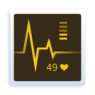

### GXDE Hardware Viewer

 **Overview 🔍** 

GXDE Hardware Manager is a lightweight hardware information viewer specifically designed for the GXDE desktop environment. It provides comprehensive system information monitoring with a clean and intuitive interface. ✨

 **Features 🚀** 

- 1. System Information 🖥️: Operating system details, kernel version, architecture, boot time

- 2. Motherboard Information 🔌: Motherboard / BIOS / system / chassis / memory-array DMI details (same info coverage as the Motherboard page of deepin-devicemanager)

- 3. CPU Monitoring 🔢: Real-time CPU usage, frequency, core information, and driver details

- 4. Memory Tracking 🧠: RAM and swap usage with detailed statistics

- 5. Storage Analysis 💾: Disk partitions, storage devices, and I/O statistics

- 6. Network Overview 🌐: Interface information, device drivers, and traffic monitoring

- 7. Display Information 🖼️: Graphics card details, resolution, color depth, and refresh rate

- 8. Audio Devices 🔊: Input/output audio devices and driver information

- 9. Input Devices ⌨️🖱️: Keyboard, mouse, and other input device detection

- 10. Driver Update ⬆️: Support for obtaining driver & kernel updates from system sources.

- 11. Multi-language Support 🌍: English and Chinese interface

- 12. Data Export 📤: Export all hardware information to JSON format on desktop

- 13. Custom Background 🖼️: You can choose your favorite image as the background.

- 14. Touchscreen Support 🖥️: Support for using the touchscreen as an input method.

 **Usage Instructions 📖** 

The application features a sidebar navigation with the following sections:

- 1. System 🖥️: Basic system and hardware overview

- 2. Motherboard 🔌: Motherboard vendor, chipset, BIOS, chassis and memory slots (DMI information)

- 3. CPU 🔢: Processor details and real-time usage monitoring

- 4. Memory 🧠: RAM and swap memory statistics

- 5. Storage 💾: Disk partitions and storage device information

- 6. Network 🌐: Network interfaces and traffic data

- 7. Display 🖼️: Graphics card and display settings

- 8. Sound 🔊: Audio input/output devices

- 9. Input Devices ⌨️🖱️: Keyboard, mouse, and other input devices

- 10. Driver Update ⬆️: Support for obtaining driver & kernel updates from system sources.

- 11. Data Export 📤: Click the menu button (☰) in the top-right corner and select "Export all information to desktop" to save a comprehensive JSON file with all hardware information. 📄

- 12. Custom Background 🖼️: Click the menu button (☰) in the top right corner, select "Set Background Wallpaper", then you can choose your favorite image as the background. If you no longer need it later, you can also select "Remove Background Wallpaper" to restore the default interface.

 **Contribution Guidelines 🤝** 

Contributions are welcome! Please feel free to submit pull requests or open issues for bugs and feature requests. 💡

 **License 📄** 

This project is licensed under the AGPL-3.0 License - see the LICENSE file for details. ⚖️

 **Acknowledgments 🙏** 

Thanks to all the open source software we've used 🎉

Thanks to all users and contributors ❤️

Special Thanks ❤️: @zeqi, @gfdgd xi, @shenmo and @CharOfString - without them, this software wouldn't exist!

 **Official Website 🌐** : [www.gxde.top](http://www.gxde.top)

